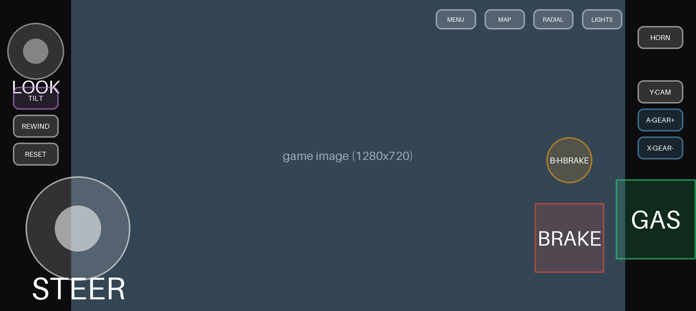

# BeamNG.drive on Android (native ARM64 + Vulkan, GameNative)

Run **BeamNG.drive** on a Snapdragon phone with [GameNative](https://github.com/utkarshdalal/GameNative), using
the game's **own ARM64 version** and its **hidden Vulkan renderer**. There's no x86 emulation and no DirectX 12 →
Vulkan translation.

On an **Honor Magic 8 Pro** it holds a steady **30 FPS at 1280×720 with the GPU at about 75%**.

> [!IMPORTANT]
> - You need to **own BeamNG.drive on Steam**. This repo contains **no game files**.
> - Not affiliated with BeamNG GmbH, GameNative, Valve or Qualcomm.
> - Experimental. Tested on **one phone** (Honor Magic 8 Pro). Use at your own risk.

## Contents
1. [Downloads](#downloads)
2. [Guide: Honor Magic 8 Pro (step by step)](#guide-honor-magic-8-pro)
3. [Guide: other phones](#guide-other-phones)
4. [Troubleshooting](#troubleshooting)
5. [How it works](#how-it-works)
6. [All the problems we hit (and the fixes)](#all-the-problems-we-hit)
7. [Benchmarks](#benchmarks)
8. [Credits and licenses](#credits-and-licenses)

---

## Downloads

Get them from the [**Releases**](../../releases/latest) page and save them on your phone (the Download folder is fine).

| File | What it is | Who needs it |
|---|---|---|
| `beamng-vkd3d-3.1-arm64-oryon.wcp` | Game-side files: ARM64 DirectX/Vulkan DLLs + the Vulkan fix, tuned for Snapdragon Oryon CPUs | Snapdragon **8 Elite** and **8 Elite Gen 5** (Magic 8 Pro) |
| `beamng-vkd3d-3.1-arm64-generic.wcp` | The same, built for any 64-bit ARM CPU (built from the same source, **not tested on a phone yet**) | All other phones |
| `Turnip-a8xx-r56-unstrict.zip` | Open-source GPU driver for **Adreno 8xx** with crash protection | Adreno 830 / 840 |
| `BeamNG_Driving.icp` | Touch controls layout (optional) | Everyone without a controller |

---

## Guide: Honor Magic 8 Pro

Tested on: Honor Magic 8 Pro (BKQ-N49), 12 GB RAM, Snapdragon 8 Elite Gen 5 (Adreno 840), Android 17,
not rooted. BeamNG.drive 0.40.6 from Steam. GameNative 1.4.1-prerelease.

### Step 1: Install GameNative and the game
1. Install **GameNative 1.4.1 or newer** from its
   [releases page](https://github.com/utkarshdalal/GameNative/releases). 1.4.0 shows "Missing interface" popups and crashes with BeamNG.
2. Sign in to Steam in GameNative and **install BeamNG.drive**. Don't start it yet.

### Step 2: Download the files
From [Releases](../../releases/latest), download:
- `beamng-vkd3d-3.1-arm64-oryon.wcp`
- `Turnip-a8xx-r56-unstrict.zip`
- `BeamNG_Driving.icp` (optional, for touch controls)

### Step 3: Install the GPU driver
GameNative → **Menu** (top right) → **Settings** → **Emulation** → **Driver Manager** →
**Import ZIP from device** → pick `Turnip-a8xx-r56-unstrict.zip`.

### Step 4: Install the game-side package
Settings → **Emulation** → **Contents Manager** → **Import .wcp from device** → pick
`beamng-vkd3d-3.1-arm64-oryon.wcp`.
It will say **"Untrusted Files Detected"** because the package contains DLLs. Tap **Install Anyway**.

### Step 5: Open the BeamNG container settings
Library → **BeamNG.drive** → **Options** → **Edit container**.

### Step 6: General tab
| Setting | Value |
|---|---|
| Wine Version | **proton-10.0-arm64ec** (it must be an **arm64ec** version) |
| Executable Path | `BinArm64/BeamNG.drive.arm64.exe` |
| Exec Arguments | `-nogfxgpudriven -gfx vk` |
| Screen Size | **1280x720** |
| Use Legacy DRM | **ON** |

### Step 7: Graphics tab
| Setting | Value |
|---|---|
| Graphics Driver | **Wrapper** |
| Graphics Driver Version | **Turnip a8xx r56 unstrict** |
| Display Server | **X11** |
| DX Wrapper | **VKD3D** |
| VKD3D Version | **3.1-arm64-beamng-oryon-1** |

Leave everything else as it is.

### Step 8: Environment tab
Swipe the tab bar to the left to find **Environment**.

| Variable | Value |
|---|---|
| `WINEDLLOVERRIDES` | `msvcp140,msvcp140_atomic_wait,vcruntime140,vcruntime140_1=b;vulkan-1=n,b` |
| `TU_DEBUG` | tick only **noconform** and **sysmem** |
| `WINEESYNC` | on (`1`) |

If a variable isn't in the list, add it with the **+** button. Copy the `WINEDLLOVERRIDES` value exactly: one missing
character and the game won't start.

### Step 9: Save
Tap the **save** button (top right). You're back on the game page.

### Step 10: First start
1. Tap **Play**. The first start takes longer because shaders are being built.
2. In BeamNG: **Options → Graphics**, choose a **Low** or **Lowest** preset to start with.
3. Start with a small or medium map (Gridmap, Utah). Big maps like West Coast USA can run out of RAM.

### Step 11: Cap the FPS at 30 (important)
While in the game, press **Back** to open GameNative's **Quick Menu** → **Performance HUD** → **FPS limiter** → **30**.
At 30 FPS the GPU has room to spare, and that's what keeps it stable. After closing the Quick Menu, tap the white
▶ **Resume** button.

### Step 12 (optional): Touch controls
Quick Menu → **Controller** → **Control Profiles** → **Import** → `BeamNG_Driving.icp` → **Apply**.
Turn **Shooter Mode off** in the same tab, or the sticks stay hidden.



Bindings: right side GAS (RT), BRAKE (LT), HANDBRAKE (B), gear up/down (A/X), camera (Y), HORN (H); left side steer
stick, look stick, REWIND/RESET, TILT (tilt-to-steer on/off); top MENU, MAP, RADIAL, LIGHTS (N).

### What you should get
- Steady 30 FPS, GPU about 75%, GPU temperature around 60 °C (with a phone cooler).
- Textures and menus look normal.

**Tips**
- A phone cooler helps a lot. Crashes happened when the phone hit "LIMIT HOT".
- Close other apps before playing (RAM).
- Screen recording or an uncapped frame rate push the GPU to 100%. Those are exactly the situations that used to crash.
  The r56 driver should recover from them, but that isn't fully confirmed yet.
- If you get **"The GPU stopped working (device lost)"** even at 30 FPS: Environment → `TU_DEBUG` → also tick
  **nolrz**.

---

## Guide: other phones

### Will it work on my phone?
| GPU | Chip (examples) | Status |
|---|---|---|
| Adreno 840 | Snapdragon 8 Elite Gen 5 | **Tested** (Magic 8 Pro). Follow the guide above. |
| Adreno 830 | Snapdragon 8 Elite | **Should work.** The r56 driver's author built and tested it on an Adreno 830, but nobody has tested BeamNG on it with this setup yet. |
| Adreno 7xx | Snapdragon 8 Gen 1 / 2 / 3, 7+ Gen 2/3, 8s Gen 3 | **Maybe.** Needs a different Turnip driver (see below). Untested. |
| Adreno 6xx and older | Snapdragon 888 and older | Unlikely: too slow and too little RAM. Untested. |
| Mali / Immortalis / Xclipse / PowerVR | MediaTek Dimensity, Exynos, Google Tensor | **Not supported.** Turnip only runs on Adreno, and only the phone's own driver is left. Untested. |

**RAM:** 12 GB or more is recommended. Even with 12 GB, the biggest maps can run out of memory. With 8 GB,
probably only small maps will load.

### What's different from the Magic 8 Pro guide
Do the same steps, with these changes.

**Package (steps 4 and 7):**
- Snapdragon **8 Elite / 8 Elite Gen 5** (Oryon CPU): `beamng-vkd3d-3.1-arm64-oryon.wcp`, VKD3D Version
  `3.1-arm64-beamng-oryon-1`.
- **Every other phone:** `beamng-vkd3d-3.1-arm64-generic.wcp`, VKD3D Version `3.1-arm64-beamng-1`.
  The Oryon one may crash on other CPUs. The generic one hasn't been tested on a phone yet. If you try it, please
  report back in [Issues](../../issues).

**GPU driver (steps 3 and 7):**
- **Adreno 8xx:** `Turnip-a8xx-r56-unstrict.zip` (same as the guide).
- **Adreno 7xx:** use a recent Turnip build for your GPU, for example from
  [StevenMXZ/Adreno-Tools-Drivers](https://github.com/StevenMXZ/Adreno-Tools-Drivers) or GameNative's Driver Manager
  list. The driver must support `VK_KHR_load_store_op_none`. If it doesn't, BeamNG says "no rendering device"
  (see [Troubleshooting](#troubleshooting)).
- If nothing else works, Graphics Driver **System** (your phone's own Qualcomm driver) renders correctly but is
  much slower (about 19 FPS on the Magic 8 Pro).

**If the Vulkan renderer doesn't work with your driver**, switch BeamNG to DirectX 12: set Exec Arguments to
just `-nogfxgpudriven`, without `-gfx vk`. It's slower (about 28 FPS at 97% GPU on the Magic 8 Pro) but works with
more drivers. Keep everything else the same.

**Weaker phones:** use Screen Size **960x540** and an FPS cap of 25 or 20.

`TU_DEBUG` only applies to Turnip drivers. On the System driver it does nothing.

---

## Troubleshooting

| What you see | Why | Fix |
|---|---|---|
| "No rendering device" / no GPU found | The driver hides `VK_KHR_load_store_op_none`, which DXVK needs to list the GPU. Common with "Android-strict" Turnip builds, like the original r56. | Use `Turnip-a8xx-r56-unstrict.zip` or another driver. Check that the driver is selected in step 7. |
| Error `c000007b` right at start | x64 DLLs in the way: wrong VKD3D version, missing `WINEDLLOVERRIDES`, or a non-arm64ec Wine | Redo steps 6–8 exactly. |
| Game doesn't start, log says "neither 32 nor 64 bit" | Use Legacy DRM is off | Turn **Use Legacy DRM** on. |
| Crash right after the loading screen (Vulkan) | `vulkan-1=n,b` missing from `WINEDLLOVERRIDES`, so the Vulkan fix DLL isn't used | Fix the variable (step 8). |
| Scrambled textures, purple walls, wrong car liveries | Old Turnip driver (for example Turnip_Gen8_V25) | Use r56 unstrict or Turnip Gen8 V39 or newer. |
| "The GPU stopped working (device lost)" | GPU faults under full load or heat (Adreno 8xx) | 30 FPS cap, phone cooler, no screen recording, tick **nolrz** in `TU_DEBUG`, use the r56 driver. |
| Game closes while loading a big map | Android killed it for RAM | Smaller map, close apps, Lowest graphics, restart the phone first. |
| "Unresponsive UI process" | `-nogfxgpudriven` missing | Add it to Exec Arguments. |
| Very low FPS | Graphics Driver is "System", or GMEM rendering | Use Turnip, keep **sysmem** ticked. |
| Touch sticks don't show | Shooter Mode is on | Quick Menu → Controller → Shooter Mode off. |
| Touches do nothing after the Quick Menu | The white ▶ Resume overlay is still up | Tap ▶. |

Don't add `breadcrumbs` to `-gfx vk`: it crashes at startup.

---

## How it works

**The usual way** to run BeamNG on Android:

```
BeamNG x64 exe ──FEX (x86 → ARM emulation)──► DirectX 12 ──vkd3d-proton──► Vulkan ──► GPU driver
```

**This way:**

```
BeamNG ARM64 exe ──Wine ARM64EC (native, no emulation)──► BeamNG's own Vulkan renderer ──► Turnip driver
```

BeamNG ships a Windows-on-ARM version (`BinArm64/BeamNG.drive.arm64.exe`), and it has a hidden Vulkan renderer
(`-gfx vk`). With both, the CPU runs the game natively and the GPU gets Vulkan directly.

What each piece does:
- **The `.wcp` package.** GameNative copies its DLLs into the container's `system32` on every launch.
  `system32` normally holds **x64** versions of the DirectX DLLs and the C++ runtime. An ARM64 program can't load
  those, and Wine stops with `c000007b` instead of falling back to its own ARM64 copies. The package has:
  - ARM64 builds of **vkd3d-proton 3.1** (d3d12) and **DXVK 3.1.1** (dxgi, d3d11, d3d10core, d3d9, d3d8).
  - **d3dcompiler_47** built from vkd3d 1.19. Wine's own version needs OpenGL, and GameNative replaces OpenGL with an x64 one.
  - Wine's ARM64 **msvcp140 / vcruntime140**.
  - **`vulkan-1.dll`, a small fix** ([source](source/vkshim/vkshim.c)). BeamNG gives its Vulkan objects debug names.
    On Android that call fails in the driver, and Wine's Vulkan layer then crashes the game on purpose (an
    assert). The fix hides the debug extensions and turns those calls into no-ops. Everything else is passed
    through. `vulkan-1=n,b` tells Wine to use it.
- **`WINEDLLOVERRIDES`** makes Wine use these ARM64 runtime DLLs and the Vulkan fix.
- **Use Legacy DRM** starts the exe directly. GameNative's normal Steam loader only understands x86 exes. The ARM64
  build doesn't use the Steam API, so it doesn't need it.
- **`-nogfxgpudriven`** turns off BeamNG's GPU-driven rendering. Turnip doesn't support the "device generated
  commands" it uses, and without the flag the game UI times out.
- **Turnip** is the open-source Mesa driver for Adreno. It's much faster than Qualcomm's driver for BeamNG's
  desktop-style renderer.
- **`TU_DEBUG=sysmem`** draws straight to memory instead of in tiles (GMEM). That's about 16% faster for BeamNG.
  `noconform` just hides a warning.
- **The r56 driver** ([Killdos26/turnip-a8xx](https://github.com/Killdos26/turnip-a8xx)) adds crash protection
  for Adreno 8xx. When the GPU reports a fault, it slows down for a few seconds ("safe mode"). If Android kills the
  GPU context anyway, it makes a new one instead of crashing the game.
- **"unstrict"**: the original r56 Android build hides 17 Vulkan extensions, including one DXVK needs.
  [`tools/patch_r56.py`](tools/patch_r56.py) unhides exactly those 17 in the official r56 zip. Nothing else is changed.

---

## All the problems we hit

In the order we ran into them:

1. **"Missing interface" popups, then a crash** (GameNative 1.4.0). Its Steam emulator was missing an interface.
   Fixed in GameNative 1.4.1.
2. **x64 version, DXVK: crash on start.** BeamNG 0.40 is DirectX 12 only. With DXVK selected, Wine's built-in
   d3d12 got used and crashed. **Fix:** DX Wrapper **VKD3D**.
3. **"Unresponsive UI process".** BeamNG asked vkd3d-proton thousands of times for a feature Turnip doesn't have
   (command signatures with root constants), and the menu UI timed out. **Fix:** `-nogfxgpudriven`.
4. **Big maps killed while loading** ("Loading Forest" on West Coast USA). The phone ran out of RAM.
   **Fix:** smaller maps, Lowest graphics, close other apps.
5. **x64 version ran through emulation and the GPU was at 97%.** Idea: BeamNG ships a native ARM64 exe. It failed
   with `c000007b` because `system32` holds x64 DLLs. No ARM64 builds of vkd3d-proton/DXVK existed, so we built them
   with llvm-mingw. Wine's d3dcompiler needs OpenGL (x64 in GameNative), so it's built from vkd3d instead.
6. **ARM64 exe refused to start: "neither 32 nor 64 bit".** GameNative's Steam loader only knows x86.
   **Fix:** Use Legacy DRM. The ARM64 build doesn't use the Steam API at all.
7. **DX12 was GPU-bound: 28 FPS at 97% GPU, about 90 °C.** Faster builds didn't help, because the GPU was the limit.
   BeamNG's ARM64 exe has a hidden Vulkan renderer: `-gfx vk`.
8. **Vulkan: crash right after the GPU was set up.** Wine asserts when the Android driver fails BeamNG's
   "name this object" debug calls. **Fix:** the `vulkan-1.dll` shim.
9. **Vulkan: scrambled textures** (wrong car liveries, purple rocks, blocky smoke), different on every start.
   We chased shader indexing (a NonUniform shader mod), queues, copy alignment, memory types and texture
   compression. The real cause was a bug in the Turnip_Gen8_V25 driver.
   **Fix:** a newer driver (Turnip Gen8 V39, later r56). The shader mod wasn't needed and cost 25% GPU, so it's not used.
10. **Tile rendering (GMEM) was slower.** **Fix:** `TU_DEBUG=sysmem` (about +16%).
11. **"The GPU stopped working (device lost)" while driving.** Theories that turned out wrong:
    - a driver wait bug (a newer Mesa with the fix crashed too);
    - screen refresh-rate switches (it crashed on X11 with no switches too).

    The pattern was clear: no crash at a 30 FPS cap, but crashes when uncapped, while screen recording, or when the
    phone was "LIMIT HOT". Adreno 8xx GPUs raise small faults under full load, and after 3 in 2 seconds Android
    kills the game's GPU context. **Fix:** a 30 FPS cap, and the r56 driver with crash protection.
12. **The r56 driver said "no rendering device".** It loaded fine, but its Android build hides 17 Vulkan
    extensions, including `VK_KHR_load_store_op_none`, so DXVK ignored the GPU. We found this with a small test
    program run on the phone. **Fix:** [`patch_r56.py`](tools/patch_r56.py), which unhides them.
    Result: "runs great now".
13. **Qualcomm's own driver** renders everything correctly but is slow: about 19 FPS at 99% GPU (stock driver),
    and barely 30 FPS at 99% with the newer 891.17. It was tuned for mobile games, not BeamNG's desktop renderer.
    Turnip is the way to go.
14. **Small ones:**
    - `-gfx vk breadcrumbs` crashes at startup.
    - Shooter Mode hides the touch sticks.
    - The Quick Menu leaves a ▶ Resume overlay that blocks touches.
    - Android's "child process restrictions" were **not** the cause of low FPS. They only kill processes; they don't
      slow anything down.

---

## Benchmarks

Honor Magic 8 Pro, Utah, standing still, phone cooler on, FPS cap 30, 1280×720, Lowest preset.

| Setup | FPS | GPU busy |
|---|---|---|
| ARM64 + DX12 (vkd3d-proton 2.14.1) | 28.5 (min 25) | 97% |
| ARM64 + DX12, GMEM instead of sysmem | 23.9 | 97% |
| ARM64 + Vulkan, stock Qualcomm driver | about 19 | 99% |
| ARM64 + Vulkan, Qualcomm 891.17 | about 30 (barely) | 99% |
| **ARM64 + Vulkan, Turnip (V39 / r56 unstrict)** | **30.0 locked** | **about 75%** |

---

## Credits and licenses

- **BeamNG.drive** © BeamNG GmbH. Not included; buy it on Steam.
- [**GameNative**](https://github.com/utkarshdalal/GameNative): the Android app that runs it all.
- [**vkd3d-proton**](https://github.com/HansKristian-Work/vkd3d-proton) (LGPL-2.1),
  [**DXVK**](https://github.com/doitsujin/dxvk) (zlib), [**vkd3d**](https://gitlab.winehq.org/wine/vkd3d) (LGPL-2.1),
  **Wine / Proton** (LGPL-2.1).
- [**Killdos26/turnip-a8xx**](https://github.com/Killdos26/turnip-a8xx) r56 by kyudongkim: the Adreno 8xx crash
  protection driver (Mesa, GPL-3.0 as a whole, partly from [Droid-Deck/drivers](https://github.com/Droid-Deck/drivers)).
- [**Mesa**](https://mesa3d.org) Turnip developers, and
  [StevenMXZ/Adreno-Tools-Drivers](https://github.com/StevenMXZ/Adreno-Tools-Drivers) for driver builds.

What's inside each download, with versions, licenses and source code: [THIRD_PARTY.md](THIRD_PARTY.md).
How to build everything yourself: [source/BUILD.md](source/BUILD.md).
This project's own files (guides, scripts, shim, controls) are under the [MIT license](LICENSE).
